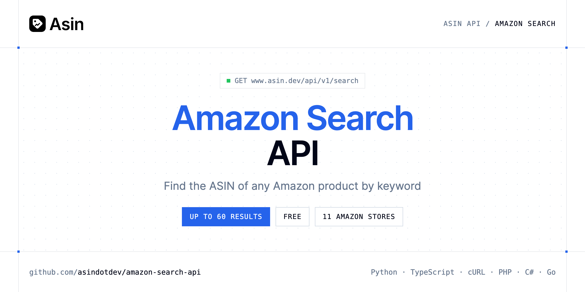

<p align="center">
  <a href="https://www.asin.dev"></a>
</p>

# Amazon Search API

[](https://www.asin.dev/signup) [](https://www.asin.dev/docs) [](LICENSE)

The **Asin Amazon Search API** returns Amazon search results (up to 60, sponsored included) so you can find the ASIN of a product, with its title, image, price, rating and number of reviews.

- **Search Amazon** — Amazon search results (up to 60, sponsored included), to find the ASIN of a product.

Use it to let users pick a product by name before tracking it, or to look up ASINs from keywords.

| Endpoint | Request | Cost |
|---|---|---|
| [Search Amazon](#search-amazon) | `GET /search` | Free |

## Table of contents

- [How it works](#how-it-works)
- [Search Amazon](#search-amazon)
- [Code examples in other languages](#code-examples-in-other-languages)
- [Use cases](#use-cases)
- [Why Asin?](#why-asin)
- [FAQ](#faq)
- [Official SDKs](#official-sdks)
- [Related repositories](#related-repositories)
- [Support](#support)

## How it works

1. **[Create an Asin account](https://www.asin.dev/signup)** and copy your API key from [your account](https://www.asin.dev/app#api).
2. **Call `https://www.asin.dev/api/v1`** with the header `Authorization: Bearer YOUR_API_KEY`.
3. **Use the result** in your app, or let Asin email you when a price moves.

```bash
export ASIN_API_KEY="your-api-key"
pip install requests        # Python
# TypeScript: Node.js 18+ (native fetch), run with `npx tsx file.ts`
```

## Search Amazon

Amazon search results (up to 60, sponsored included), to find the ASIN of a product. Free, limited to 30 searches per hour.

`GET https://www.asin.dev/api/v1/search` · **Free** · [API reference](https://www.asin.dev/docs)

### Request parameters

| Parameter | In | Type | Required | Description |
|---|---|---|---|---|
| `query` | query | string | ✅ | Keywords |
| `marketplace` | query | string (`com`, `co.uk`, `de`, `fr`, `it`, `es`) | — | Amazon store, e.g. com for amazon.com |

### Python example

```python
import os

import requests

API_KEY = os.environ["ASIN_API_KEY"]
HEADERS = {"Authorization": f"Bearer {API_KEY}"}

response = requests.get(
    "https://www.asin.dev/api/v1/search",
    headers=HEADERS,
    params={
        "query": "wireless earbuds",
        "marketplace": "com",
    },
    timeout=120,
)
response.raise_for_status()

data = response.json()
print(data)
```

### TypeScript example

```typescript
type SearchAmazon = {
  results?: {
    asin?: string;
    title?: string;
    image?: string;
    price?: number;
    currency?: string;
    rating?: number;
    reviews_count?: number;
  }[];
};

const headers = { Authorization: `Bearer ${process.env.ASIN_API_KEY!}`, "Content-Type": "application/json" };

const params = new URLSearchParams({
  "query": "wireless earbuds",
  "marketplace": "com",
});

const response = await fetch(`https://www.asin.dev/api/v1/search?${params}`, { headers });
if (!response.ok) throw new Error(`HTTP ${response.status}: ${await response.text()}`);

const data = (await response.json()) as SearchAmazon;
console.log(data);
```

### Output example

Example response from the API reference, abridged.

```json
{
  "results": [
    {
      "asin": "B09DFCB66S",
      "title": "Wireless Earbuds, Bluetooth 5.3, Noise Cancelling",
      "image": "https://m.media-amazon.com/images/I/…jpg",
      "price": 79.99,
      "currency": "USD",
      "rating": 4.4,
      "reviews_count": 12873
    }
  ]
}
```

### Response fields

| Field | Type | Description |
|---|---|---|
| `results[]` | object[] |  |
| `results[].asin` | string | 10-character ASIN, to track or read its history |
| `results[].title` | string | Product title |
| `results[].image` | string | Main product image |
| `results[].price` | number | Price shown in the results |
| `results[].currency` | string | ISO 4217 code of the marketplace |
| `results[].rating` | number | Average rating out of 5 |
| `results[].reviews_count` | integer | Number of reviews |

## Code examples in other languages

Ready-to-run examples live in [`examples/`](examples); each reads your key from `ASIN_API_KEY`.

| Language | `search` |
|---|---|
| cURL (Bash) | [search.sh](examples/curl/search.sh) |
| PHP | [search.php](examples/php/search.php) |
| C# | [Search.cs](examples/csharp/Search.cs) |
| Go | [search.go](examples/go/search.go) |
| Java | [SearchExample.java](examples/java/SearchExample.java) |
| Ruby | [search.rb](examples/ruby/search.rb) |
| Node.js | [search.mjs](examples/nodejs/search.mjs) |

## Use cases

- **ASIN lookup** — Turn a product name into an ASIN.
- **Product pickers** — Let users search Amazon from your app, then track what they choose.
- **Assortment checks** — See what comes up for a keyword on each marketplace.

## Why Asin?

- **A watchlist that runs on its own** — each product is checked on schedule, from every 5 minutes to every 24 hours depending on the plan.
- **Price history for any ASIN** — read every price Asin has seen, free and without tracking the product.
- **Alerts by email** — price drops, target prices and products back in stock.
- **Pay for what you check** — each price check costs 1 credit (about 30 credits a month for a product checked daily) and failed checks are refunded. Free for 50 products.
- **Use it your way** — the same API key works with the REST API, the MCP server and the Chrome extension, with official SDKs in 7 languages.
- **Copy-paste examples** — Python and TypeScript in each README, 7 more languages in `examples/`.

## FAQ

### How do I authenticate?

[Create an Asin account](https://www.asin.dev/signup), copy your API key from [your account](https://www.asin.dev/app#api) and send it as `Authorization: Bearer YOUR_API_KEY` with every request to `https://www.asin.dev/api/v1`. Keys start with `asin_`.

### How much does it cost?

`GET /search`: Free. Asin is free for 50 products; a product checked daily uses about 30 credits a month and failed checks are refunded. See [Asin pricing](https://www.asin.dev/pricing).

### Is it really free?

Yes, no credit is used. It is limited to 30 searches per hour.

### Which Amazon stores are supported?

11 marketplaces, set with `marketplace`: `com` (default), `co.uk`, `de`, `fr`, `it`, `es`, `ca`, `co.jp`, `com.br`, `com.mx` and `in`.

### Is there an official SDK?

Yes: [Python](https://github.com/asindotdev/asin-python), [Node.js & TypeScript](https://github.com/asindotdev/asin-node), [Go](https://github.com/asindotdev/asin-go), [PHP](https://github.com/asindotdev/asin-php), [Ruby](https://github.com/asindotdev/asin-ruby), [Java](https://github.com/asindotdev/asin-java) and [.NET](https://github.com/asindotdev/asin-dotnet), plus a [CLI](https://github.com/asindotdev/asin-cli) and an [MCP server](https://github.com/asindotdev/asin-mcp). The examples here use plain HTTP so you can see the raw API.

### Which languages are supported?

Any language that can make an HTTP request. This README shows Python and TypeScript; the [`examples/`](examples) folder contains cURL, PHP, C#, Go, Java, Ruby and Node.js.

## Official SDKs

Use Asin from your own language with a typed client:

| SDK | Package | Install |
| --- | --- | --- |
| Node.js | [`@asindev/sdk`](https://www.npmjs.com/package/@asindev/sdk) | `npm install @asindev/sdk` |
| Python | [`asindotdev`](https://pypi.org/project/asindotdev/) | `pip install asindotdev` |
| Go | [`asin-go`](https://pkg.go.dev/github.com/asindotdev/asin-go) | `go get github.com/asindotdev/asin-go` |
| .NET | [`Asin`](https://www.nuget.org/packages/Asin) | `dotnet add package Asin` |
| Ruby | [`asindotdev`](https://rubygems.org/gems/asindotdev) | `gem install asindotdev` |
| PHP | [`asindotdev/sdk`](https://packagist.org/packages/asindotdev/sdk) | `composer require asindotdev/sdk` |
| Java | [`asin-java`](https://github.com/asindotdev/asin-java) | build from source, see its README |
| CLI | [`@asindev/cli`](https://www.npmjs.com/package/@asindev/cli) | `npm install -g @asindev/cli` |
| MCP server | [`@asindev/mcp`](https://www.npmjs.com/package/@asindev/mcp) | `npx -y @asindev/mcp` |

## Related repositories

- [Amazon Price Tracker API](https://github.com/asindotdev/amazon-price-tracker-api)
- [Amazon Price History API](https://github.com/asindotdev/amazon-price-history-api)
- [Amazon Price Alerts API](https://github.com/asindotdev/amazon-price-alerts-api)
- [Amazon Offers API](https://github.com/asindotdev/amazon-offers-api)
- [All Asin repositories](https://github.com/asindotdev)

## Support

- 📚 Read the [API reference](https://www.asin.dev/docs).
- ✉️ Write to [contact@asin.dev](mailto:contact@asin.dev).
- 🔑 [Get your API key](https://www.asin.dev/signup).

---

<p align="center">
  <a href="https://www.asin.dev">
    <picture>
      <source media="(prefers-color-scheme: dark)" srcset="images/logo-dark.svg">
      
    </picture>
  </a>
  <br>
  <sub>Built by <a href="https://www.asin.dev">Asin</a>. Examples are released under the MIT license.</sub>
</p>
